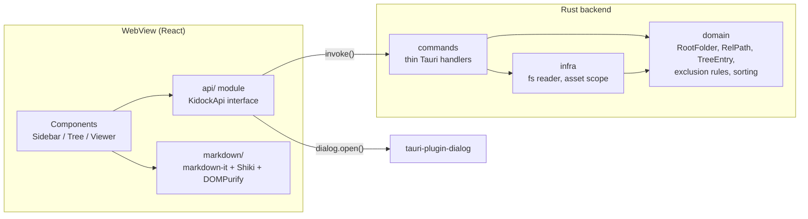
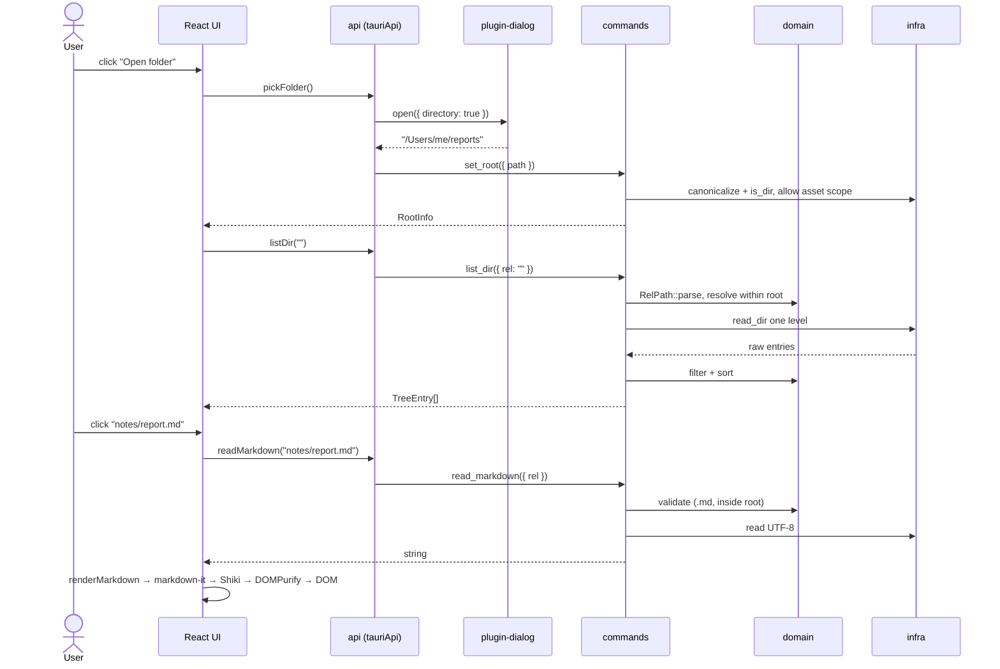
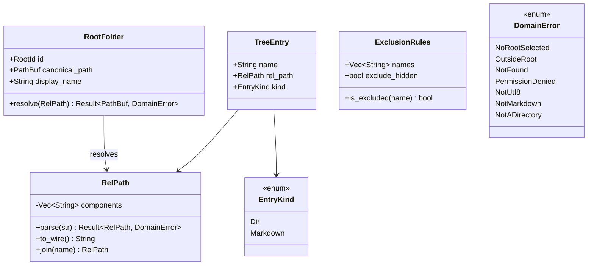

# Issue #1 — Design

## Tech Stack Decisions

Versions are the latest stable releases as of 2026-11-23 (checked with `npm view` / `cargo info`). Exact versions are pinned by the lockfiles at scaffold time.

| Area | Decision | Rationale |
|---|---|---|
| Shell | **Tauri 2.12.x** (Rust 1.90+) | Small binaries, OS WebView, capability-based permissions. Tauri 3 is still alpha. |
| Frontend | **React 19 + TypeScript + Vite 8** | The owner already works in React (lower maintenance cost). Large ecosystem for tree/virtual-list components (`@tanstack/react-virtual` for #3). Svelte's smaller bundle matters little in a desktop app. |
| Package manager | **npm** | Same as the owner's other projects; no extra tool needed in CI. |
| Markdown | **markdown-it 15** (GFM tables/strikethrough/linkify built in) + `markdown-it-task-lists`-style plugin for task lists | Mature, plugin ecosystem, sync API. Easy to add Mermaid fences and link/image rewriting in #5. |
| Highlighting | **Shiki 4**, fine-grained core build (`shiki/core`) with the **JavaScript regex engine** and a curated set of languages, loaded lazily | Accurate VS Code-grade highlighting. The JS engine avoids WebAssembly, so the CSP does not need `'wasm-unsafe-eval'`. A curated language set keeps the bundle reasonable. |
| Sanitization | **DOMPurify 3** on the final HTML string | De-facto standard, maintained against mXSS. Runs after markdown-it and Shiki, so nothing bypasses it. |
| Mermaid | mermaid 12 — **deferred to #5** | Not needed in this slice. |
| Persistence | **SQLite via `rusqlite` (bundled), owned by the Rust backend** — introduced in #3 | The unread state is written by the Rust watcher even when the UI is idle. It must handle thousands of entries with per-folder counts and atomic updates. A JSON key-value store (`tauri-plugin-store`) would rewrite the whole file on each change and needs manual aggregation. This Issue persists nothing. |
| File watching | `notify` 9 + `notify-debouncer-full` 0.8 — **introduced in #3** | As planned. |
| Notifications | `tauri-plugin-notification` 2.8 — **introduced in #4** | As planned. |
| Folder picker | `tauri-plugin-dialog` 2.8 (`open({ directory: true })` from JS) | Official plugin. Only the `dialog:allow-open` permission is granted. |
| File reading | **Custom Rust commands** (not `tauri-plugin-fs`) | Lets the backend enforce "only inside registered folders" in one place, and keeps the WebView's capabilities minimal. |
| Testing | `cargo test` / `clippy` / `fmt`. Vitest 5 + Testing Library (jsdom). `@tauri-apps/api/mocks` (`mockIPC`, `clearMocks`) for IPC-level tests | — |

## Architecture Overview



- **domain** (pure, no Tauri, no I/O): path validation/normalization, exclusion rules, entry filtering and sorting, error types.
- **infra**: reads directories and files with `std::fs` and maps OS errors to domain errors. Extends the asset protocol scope via `Manager::asset_protocol_scope().allow_directory(path, true)` (needs the `protocol-asset` cargo feature; verified in tauri 2.12.7 source).
- **commands**: `#[tauri::command]` functions holding `State<AppState>`. No logic beyond wiring and error conversion.

## Component Design

### Rust (`src-tauri/src/`)

```
lib.rs            // builder: plugins, state, invoke_handler
domain/
  mod.rs
  root.rs         // RootFolder { id, canonical path }
  rel_path.rs     // RelPath: validated relative path (no "..", no absolute, no prefix)
  entry.rs        // TreeEntry { name, rel_path, kind: Dir|Markdown }
  filter.rs       // ExclusionRules (default: .git, node_modules, dot-entries) + is_markdown
  sort.rs         // dirs first, then case-insensitive name
  error.rs        // DomainError (OutsideRoot, NotFound, PermissionDenied, NotUtf8, NotMarkdown, NoRootSelected)
infra/
  mod.rs
  fs_reader.rs    // list_dir(root, rel) -> Vec<RawEntry>, read_text(root, rel) -> String
  asset_scope.rs  // allow_root(app, root)
commands/
  mod.rs          // select_root, list_dir, read_markdown
state.rs          // AppState { root: Mutex<Option<RootFolder>> }
```

**Commands (IPC contract)**

| Command | Args | Returns | Notes |
|---|---|---|---|
| `set_root` | `{ path: string }` | `RootInfo { id, name, path }` | Canonicalizes the path and checks that it is a directory. Replaces any previous root. Adds it to the asset scope (for #5 images; an old root's scope cannot be revoked by API, so we also check paths ourselves). |
| `list_dir` | `{ rel: string }` (`""` = root) | `TreeEntry[]` | Validates `rel`, lists one level, filters (dirs + `.md`, exclusions), sorts. |
| `read_markdown` | `{ rel: string }` | `string` | Validates `rel`, requires the `.md` extension, reads UTF-8. Rejects anything outside the root. |

**Path safety (the core rule)**: the frontend never sends absolute paths except the one returned by the folder dialog to `set_root`. All later requests use a `rel` path, handled as follows:

1. `RelPath::parse` rejects absolute paths, Windows prefixes/drive letters, `..` components, and empty segments, and normalizes `\` and `/` into components.
2. `root.join(rel)` is canonicalized, and the result must `starts_with(root)`. This catches symlinks that escape the root.

Both steps are unit-tested. Step 2 uses temp dirs, including a symlink case. On Windows, `canonicalize` returns `\\?\` paths, so the root is canonicalized the same way and they compare consistently. Wire format: `rel` always uses `/`, and the domain converts to and from `PathBuf`.

**Errors over IPC**: commands return `Result<T, CommandError>`. `CommandError` serializes as `{ kind: "OutsideRoot" | "NotFound" | ..., message }` so the UI can show specific states (F4).

### Frontend (`src/`)

```
api/
  types.ts          // RootInfo, TreeEntry, CommandError
  kidockApi.ts      // interface KidockApi { pickFolder(); setRoot(); listDir(); readMarkdown() }
  tauriApi.ts       // real impl: invoke() + plugin-dialog
  mockApi.ts        // in-memory fake tree for browser dev + tests
  index.ts          // chooses impl: VITE_API_MOCK=true -> mock, else tauri
markdown/
  render.ts         // renderMarkdown(src): Promise<string> (markdown-it -> Shiki -> DOMPurify)
  highlighter.ts    // lazy singleton Shiki core highlighter, curated langs, JS regex engine
components/
  App.tsx           // layout, selected root + file state
  Sidebar.tsx       // "Open folder" button + Tree
  TreeNode.tsx      // expand/collapse, lazy children via api.listDir
  Viewer.tsx        // loads file, renders sanitized HTML, empty/error states
```

- The rendered HTML is injected with `dangerouslySetInnerHTML` **only** from `renderMarkdown`'s DOMPurify output. This is the single sink.
- DOMPurify config: default profile, plus forbidding `style` attributes (except on Shiki's `<span>`/`<pre>`, handled by a hook), `iframe`, `object`, `embed`, and `form`. Only `http`, `https`, `mailto`, and `#` URLs are allowed in links.
- Link clicks in the Viewer are intercepted with `preventDefault` so the WebView never navigates away. In-app `.md` links and opening external URLs come in #5. In this Issue, clicks are simply inert.
- Shiki: themes `github-light` / `github-dark`, following `prefers-color-scheme`. Unknown languages fall back to plain `<pre><code>`.

### Security configuration (`tauri.conf.json`)

```jsonc
"app": {
  "security": {
    "csp": {
      "default-src": "'self'",
      "script-src": "'self'",
      "style-src": "'self' 'unsafe-inline'",   // Shiki emits inline styles (and mermaid will in #5)
      "img-src": "'self' asset: http://asset.localhost data:",
      "font-src": "'self'",
      "connect-src": "ipc: http://ipc.localhost",
      "object-src": "'none'",
      "frame-src": "'none'",
      "base-uri": "'none'",
      "form-action": "'none'"
    },
    "freezePrototype": true,
    "assetProtocol": { "enable": true, "scope": [] }   // extended at runtime to the picked root only
  }
}
```

- Tauri hashes local scripts and adds nonces at build time (per the Tauri CSP docs). `asset:` and `http://asset.localhost` are listed explicitly: macOS uses `asset://localhost/...`, Windows uses `http://asset.localhost/...` (verified in tauri 2.12.7 `core.js`).
- Capabilities (`capabilities/default.json`): `core:default` and `dialog:allow-open` only. No `fs` plugin permissions.
- Exact CSP keys and capability identifiers are re-verified against the docs and the generated schema during scaffolding.

## Data Flow



## Domain Models



- `RootId` is a newtype. In this Issue there is one root. In #3 it becomes a key for multiple roots, and the commands will take `(root_id, rel)`.
- `ExclusionRules` is a value with defaults now, and becomes user-configurable in #3.
- `.md` detection is case-insensitive on the extension (`.md`, `.MD`).

## Notes for Later Issues

- #3: switch `AppState.root` to a map of roots and add `rusqlite`. Tree virtualization (`@tanstack/react-virtual`) if lazy loading alone is not enough.
- #5: link/image rewriting goes into `markdown/render.ts` before DOMPurify. Relative images resolve against the `.md` file's directory and use `convertFileSrc`. The resolved path is re-checked against the root.
