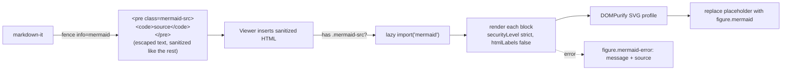
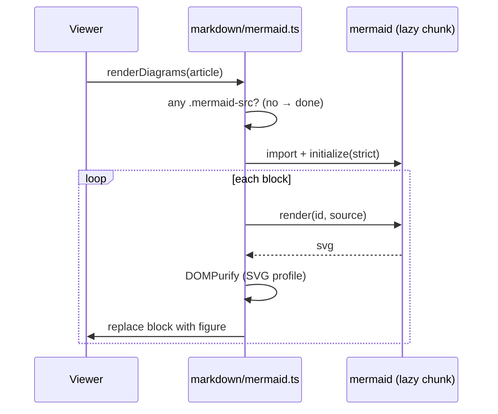

# Issue #10 — Design

Verified 2026-11-24 against `mermaid` 12.3.0 (npm latest, released 2026-11-03):
- `mermaid.initialize(config)` and `mermaid.render(id, text) → Promise<{ svg, diagramType, bindFunctions }>`.
- `securityLevel: 'strict' | 'loose' | 'antiscript' | 'sandbox'`. Root-level `htmlLabels` (the per-diagram settings are deprecated).
- No `eval` / `new Function` in any of the 281 dist modules.

## Architecture Overview

## Component Design

- `markdown/render.ts`: the fence renderer emits a `mermaid` fence as `<pre class="mermaid-src"><code>…escaped…</code></pre>`, without Shiki.
- `markdown/mermaid.ts`:
  - `renderDiagrams(root: HTMLElement, opts: { dark: boolean, isCurrent: () => boolean })`:
    1. Return immediately if `root` has no `.mermaid-src`; nothing is loaded.
    2. Otherwise `await import("mermaid")` and initialize it once per theme: `{ startOnLoad: false, securityLevel: "strict", htmlLabels: false, theme: dark ? "dark" : "default", suppressErrorRendering: true }`.
    3. Render each block in order with a unique id.
    4. Sanitize the SVG with the SVG purifier (`USE_PROFILES: { svg: true, svgFilters: true }`, `FORBID_TAGS: ["foreignObject", "script"]`). The `<style>` element inside the SVG is kept, since Mermaid's look depends on it, and CSS cannot run script.
    5. Swap the block with `<figure class="mermaid">`. A failure becomes `<figure class="mermaid-error" role="note">`, with the error message and the escaped source as text.
    6. Stop when `isCurrent()` becomes false (a newer load).
  - The module is loaded with the same lazy `import()` pattern, so Vite splits it into its own chunk.
- `Viewer`: after the HTML is in the DOM (layout effect on `view`), call `renderDiagrams(articleRef, { dark: matchMedia('(prefers-color-scheme: dark)').matches, isCurrent })`. Diagrams render after the scroll position is restored. They change heights, so a reload restores the offset again once they are done.
- CSS: `figure.mermaid` (centered, `max-width: 100%`, scrolls horizontally if wider) and `figure.mermaid-error` (danger border, monospace source).

## Testing

- Unit tests (jsdom, Mermaid mocked with `vi.mock`):
  - placeholder emission
  - no import without blocks
  - SVG sanitization strips `script` / `on*` / `foreignObject`
  - error box
  - stale loads stop
- Real rendering in headless Chrome against the mock build:
  - samples render as `<svg>`
  - an injection sample leaves no script/handlers
  - the invalid sample shows the error box
  - the production CSP emulation (from #1) reports no `script-src` violations from Mermaid

## Data Flow

## Domain Models

None (rendering only).
