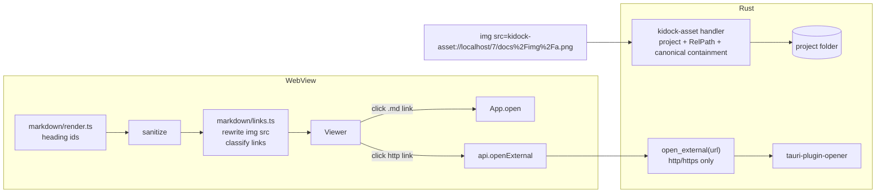
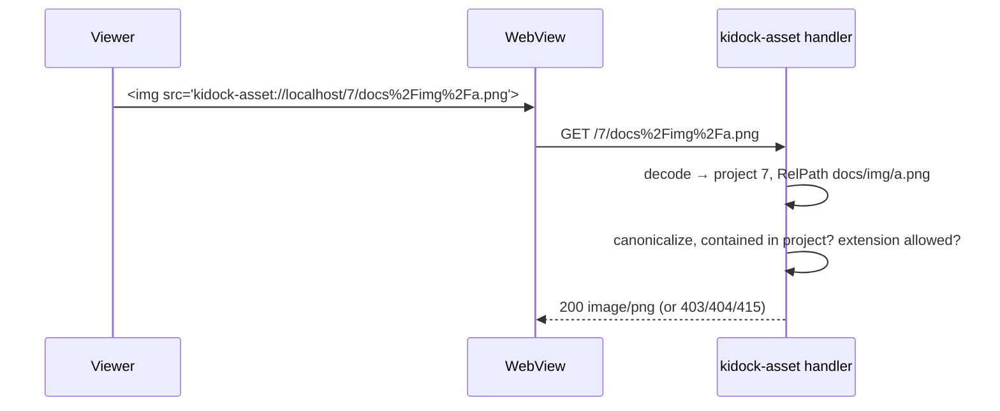

# Issue #11 — Design

Verified 2026-11-24 against the sources:
- Tauri 2.12.7: `Builder::register_asynchronous_uri_scheme_protocol(name, |ctx, request, responder|)`.
  - Origins: `<scheme>://localhost/…` on macOS/Linux, `http://<scheme>.localhost/…` on Windows.
  - The JS `convertFileSrc(path, protocol)` builds the platform URL (it URL-encodes the path).
- `tauri-plugin-opener` 2.7.3: Rust `app.opener().open_url(url, None::<&str>)`. 3.x is alpha.

## Architecture Overview

The image URL is built from `"{projectId}/{relPath}"` passed through `convertFileSrc(…, "kidock-asset")`.

## Component Design

### Frontend

- `markdown/paths.ts` (pure): `resolveRelative(fromFile: string, target: string): string | null`. It joins the target to the file's directory, normalizes `.` and `..`, and returns `null` if the result escapes the project root. A leading `/` means the project root. URL-encoded targets (`a%20b.png`) are decoded.
- `markdown/render.ts`:
  - Heading ids via a markdown-it core rule (GitHub-style slug, with uniqueness suffixes).
  - `renderMarkdown(src, { projectId, relPath, assetUrl })` runs a DOMPurify `afterSanitizeAttributes` hook, scoped to this call:
    - ``: a relative `src` becomes `assetUrl(projectId, resolved)`. `http(s)` sources are removed (with `data-blocked-src` and a class for the placeholder). `data:` stays.
    - `<a>`: a relative `.md` href gets `data-md-link="<resolved>"` (plus `data-anchor`). Other relative hrefs get `data-local-link` and are made inert. `#x` gets `data-anchor`. `http(s)`/`mailto` get `data-external`.
  - IDs are prefixed (`user-content-…`, like GitHub) and in-document anchors map to them, so headings cannot clobber DOM globals.
- `KidockApi`:
  - `assetUrl(projectId, relPath): string`: tauri uses `convertFileSrc(\`${projectId}/${relPath}\`, "kidock-asset")`; the mock returns a data URL placeholder.
  - `openExternal(url): Promise<void>`.
- `Viewer`: its click handler routes `data-md-link` → `onOpenLink(relPath, anchor)`, `data-anchor` → scroll to `#user-content-<anchor>`, `data-external` → `api.openExternal`, and everything else to `preventDefault`. After a file opens with a pending anchor, it scrolls to it.
- `App`: `onOpenLink` → `open({ projectId, relPath })` with a pending anchor.

### Rust

- `infra/asset_protocol.rs`:
  - `handle(state, uri_path) -> Response`:
    1. Percent-decode the path, then split `"<id>/<rel>"`.
    2. Look up the project (404 if unknown or unavailable).
    3. Parse with `RelPath`; containment goes through `fs_reader::resolve` (403 when outside).
    4. Check the extension against the allowlist (415 otherwise), read the file (404), and answer with the `Content-Type`, `Cache-Control: no-cache`, and `X-Content-Type-Options: nosniff`.
  - It runs on a spawned thread, because the handler must not block.
  - It is pure enough to unit-test with a temp dir (no Tauri): `serve(state, path) -> (status, content_type, body)`.
- `domain/percent.rs`: `percent_decode(&str) -> Option<String>`, which rejects invalid UTF-8 and malformed escapes.
- `commands::open_external(url)`: parse the scheme, accept only `http` and `https`, then call `app.opener().open_url`.
- `lib.rs`: register the scheme and the opener plugin. **No opener capability** is added for the WebView.
- `tauri.conf.json` CSP `img-src`: add `kidock-asset: http://kidock-asset.localhost`. The old `asset:` / `http://asset.localhost` entries and `assetProtocol` (unused since this Issue) are removed, along with `infra::asset_scope`.

## Data Flow

## Domain Models

No persistent models: this is URL and path handling only (`RelPath` reused).
