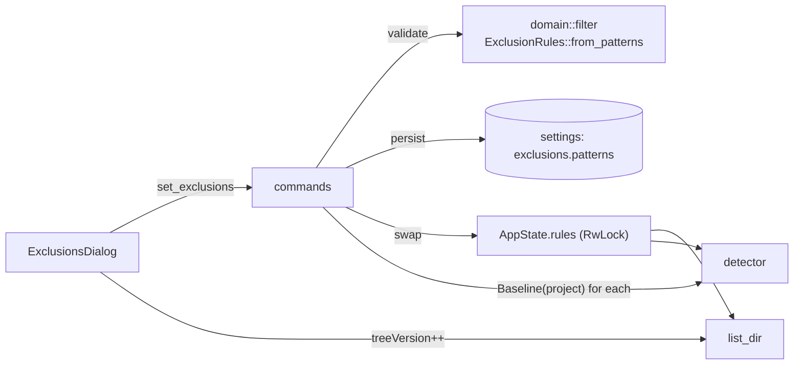
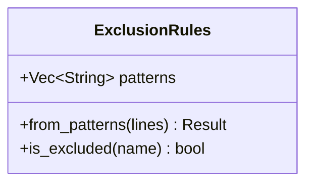

# Issue #12 — Design

## Architecture Overview



## Component Design

### domain (`filter.rs`)

- `glob_match(pattern, name) -> bool`: case-insensitive (ASCII), `*` / `?`, greedy two-pointer matching with backtracking to the last `*`. That is O(n·m) worst case with no regex.
- `ExclusionRules { patterns: Vec<String> }`:
  - `default()` returns the list from F2.
  - `from_patterns(lines) -> Result<Self, DomainError>` trims lines, drops blanks, and rejects separators or more than 200 patterns with `InvalidPath(reason)`.
  - `is_excluded(name)` is true if any pattern matches.
  - `is_tracked` is unchanged (it uses `is_excluded`).

### state

- `rules: RwLock<Arc<ExclusionRules>>`, loaded from settings, or the defaults if absent or unreadable.
- `rules() -> Arc<ExclusionRules>`: a cheap snapshot, so callers never hold the lock during I/O.
- `set_rules(rules)`: persists the JSON array, then swaps.
- Callers (`list_dir`, `detector`, `scan`) take a snapshot at the start of each operation.

### commands

| Command | Args | Returns |
|---|---|---|
| `get_exclusions` | – | `{ patterns: string[], defaults: string[] }` |
| `set_exclusions` | `{ patterns: string[] }` | `string[]` (normalized). Re-baselines every available project. |

### Frontend

- `KidockApi.getExclusions()` and `setExclusions(patterns)`.
- `ExclusionsDialog` (built on `Modal`): a textarea plus validation feedback from the backend error message. **Reset to defaults** fills in the defaults.
- `Sidebar` footer: an "Exclusions" button next to the notifications toggle.
- `App`: after a successful save, increment `treeVersion` so open trees refetch.

## Data Flow

```mermaid
sequenceDiagram
  participant U as Owner
  participant D as ExclusionsDialog
  participant C as set_exclusions
  participant Det as detector
  U->>D: add "scratch" → Save
  D->>C: ["…defaults", "scratch"]
  C->>C: validate, persist, swap rules
  C->>Det: Baseline(p) for each project (silent)
  C-->>D: normalized patterns
  D-->>U: close; tree refreshes (scratch/ hidden)
```

## Domain Models


