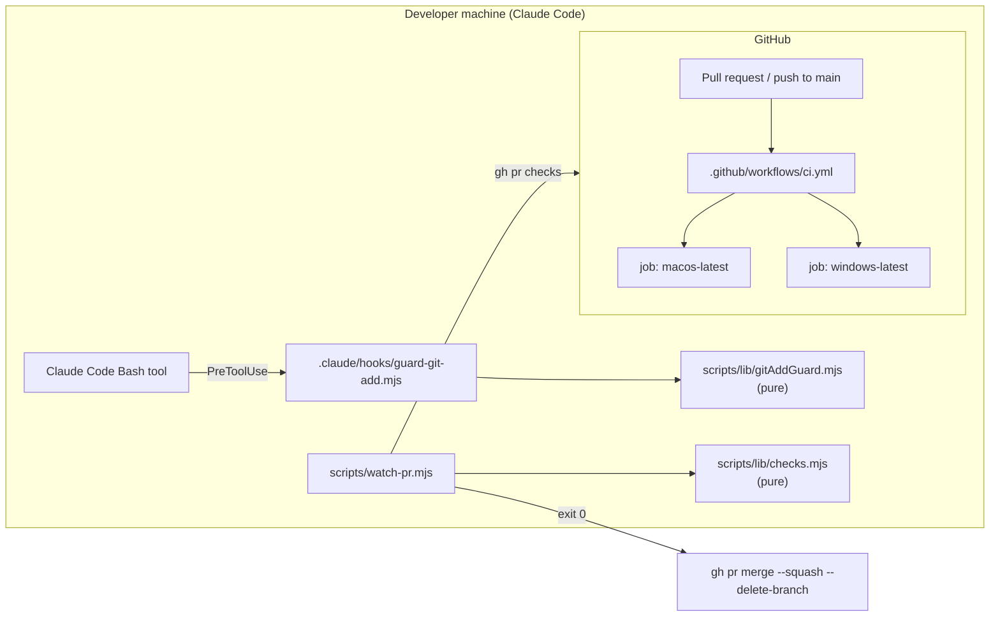
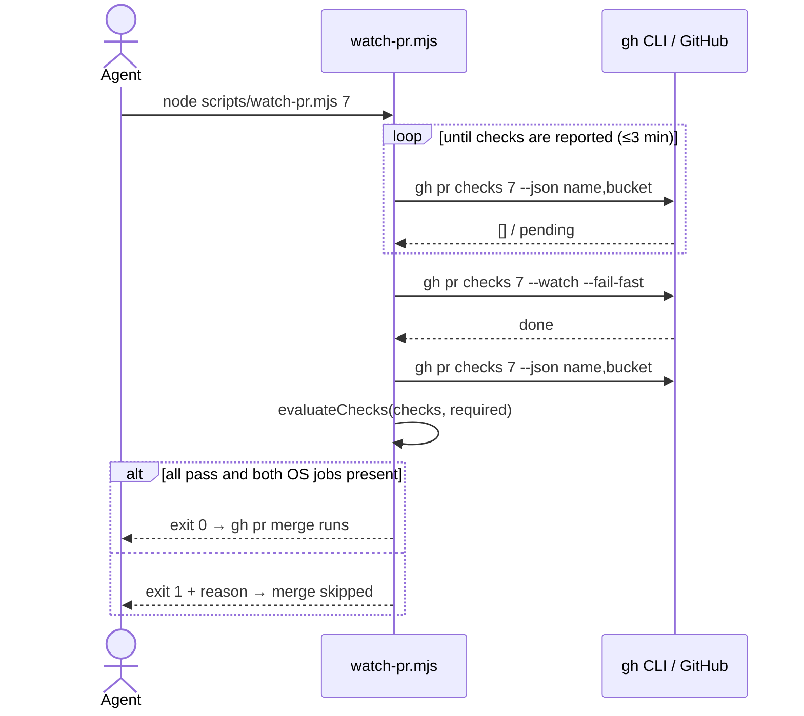
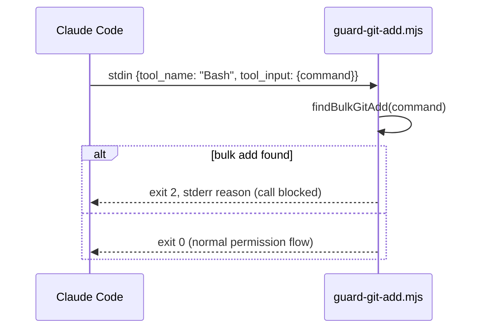

# Issue #2 — Design

## Architecture Overview



Three independent pieces:

1. **CI workflow** (`.github/workflows/ci.yml`): one job, OS matrix.
2. **Watch-and-merge** (`scripts/watch-pr.mjs` + `scripts/lib/checks.mjs`).
3. **Git add guard** (`.claude/settings.json` → `.claude/hooks/guard-git-add.mjs` → `scripts/lib/gitAddGuard.mjs`).

The pure logic sits in `scripts/lib/` so Vitest can test it. Thin entry points do the I/O.

## Component Design

### 1. CI workflow

```yaml
name: CI
on:
  pull_request:
    branches: [main]
  push:
    branches: [main]
permissions:
  contents: read
concurrency:
  group: ci-${{ github.ref }}
  cancel-in-progress: true
jobs:
  check:
    name: check (${{ matrix.os }})
    strategy:
      fail-fast: false        # see both OS results even if one fails
      matrix:
        os: [macos-latest, windows-latest]
    runs-on: ${{ matrix.os }}
    steps:
      - actions/checkout@v7
      - actions/setup-node@v7  (node-version-file: .nvmrc, cache: npm)
      - dtolnay/rust-toolchain@stable (components: clippy, rustfmt)
      - Swatinem/rust-cache@v2 (workspaces: src-tauri)
      - npm ci
      - cargo fmt --check / clippy / test   (--manifest-path src-tauri/Cargo.toml)
      - npm run typecheck / npm test
      - npm run tauri build -- --debug --no-bundle
```

- `fail-fast: false` keeps the other OS running, so one failure doesn't hide the other.
- Node version comes from a new `.nvmrc` (`22`), matching `engines` and the local nodebrew v22.
- `--no-bundle` and `--debug` were checked against the local `tauri build --help` (CLI 2.x). The debug build reuses most of the `cargo test` / `clippy` artifacts.
- `cargo fmt` runs on both OSes. It is cheap, and it catches line-ending surprises on Windows checkouts.
- Line endings: add `.gitattributes` with `* text=auto eol=lf`, so `cargo fmt --check` sees LF files on the Windows runner too.
- `concurrency` cancels superseded runs on the same ref. The merge check reads the latest run only.

### 2. Watch-and-merge

Usage (documented in `CLAUDE.md`):

```bash
node scripts/watch-pr.mjs <PR> && gh pr merge <PR> --squash --delete-branch
```

`scripts/watch-pr.mjs <PR>`:

1. **Wait for checks to appear** (up to ~3 min): poll `gh pr checks <PR> --json name,bucket,workflow`. Right after a push, GitHub may report "no checks" (exit 1) or pending (exit 8).
2. **Watch**: `gh pr checks <PR> --watch --fail-fast --interval 15` (flags checked in `gh pr checks --help`, gh 2.95), inheriting stdio so progress is visible.
3. **Re-read and decide** with `evaluateChecks(checks, requiredNames)`. The exit code of `--watch` alone is not trusted. The final decision is made on the JSON:
   - every check's `bucket` is `pass` or `skipping` → OK
   - any `fail` / `cancel` → fail
   - any `pending` → fail (should not happen after watch)
   - zero checks → fail
   - a required check name missing (`check (macos-latest)`, `check (windows-latest)`) → fail
4. Exit `0` only for OK. Print the reason otherwise.

The required names default to the two matrix job names. They can be overridden with `--require <name>` (repeatable) if the workflow changes.

**Watching `main` after the merge** (F3), documented as a command:

```bash
gh run watch "$(gh run list --branch main --commit "$(git rev-parse origin/main)" --workflow CI --limit 1 --json databaseId -q '.[0].databaseId')" --exit-status
```

`gh run list --commit/--workflow/--json` and `gh run watch --exit-status` were checked in `--help` (gh 2.95). Run it after `git fetch`.

### 3. Git add guard

`.claude/settings.json` (committed, shared):

```json
{
  "hooks": {
    "PreToolUse": [
      {
        "matcher": "Bash",
        "hooks": [
          {
            "type": "command",
            "command": "node",
            "args": ["${CLAUDE_PROJECT_DIR}/.claude/hooks/guard-git-add.mjs"],
            "timeout": 10,
            "onFailure": "block"
          }
        ]
      }
    ]
  }
}
```

- Exec form (`command` + `args`, no shell) as the hooks docs recommend for path placeholders. On Windows, exec form needs a real `.exe`, and `node.exe` is one.
- `onFailure: "block"` fails closed if the hook times out (Claude Code v2.1.295+). Re-check this key against the installed version's docs during implementation, and drop it if the key is rejected.
- No `if` filter: the docs call it best-effort, and the script filters cheaply itself.

`.claude/hooks/guard-git-add.mjs` reads the PreToolUse JSON from stdin, takes `tool_input.command`, and calls `findBulkGitAdd(command)`. If it finds a match, it writes the reason to stderr and exits with code `2`, which blocks the call and shows stderr to Claude. Otherwise it exits `0`. Unparseable input exits `0`, because the guard must not break unrelated tools.

`scripts/lib/gitAddGuard.mjs` exports `findBulkGitAdd(command): string | null`, which returns a reason or `null`:

1. Split into simple commands on `&&`, `||`, `;`, `|`, `&`, and newlines, and pull out the contents of `$( … )` and backticks. Tokenize with single and double quotes respected.
2. For each simple command, skip leading `VAR=value` assignments. If the program is `git`, skip git's global options (`-C <dir>`, `-c <k=v>`, `--git-dir=…`, `--work-tree=…`, `--no-pager`, etc.). Then check whether the subcommand is `add`.
3. Block when an `add` argument is:
   - `-A`, `--all`, `-u`, `--update`, `--no-ignore-removal`, or a combined short flag containing `A` or `u` (e.g. `-Av`)
   - a pathspec of `.`, `./`, `:/`, `:`, `*`, or `:/*`, including after `--`
4. Everything else passes, e.g. `git add src/a.ts`, `git add -p file`, `git add -N file`, `git status`, `echo "git add ."` (quoted text is a single token of `echo`).

This is a guard against the agent's habits, not a sandbox. Odd constructions like `eval`, aliases, or `sh -c "…"` are not covered. This is documented in `CLAUDE.md`.

## Data Flow





## Domain Models

```mermaid
classDiagram
  class Check {
    +string name
    +Bucket bucket
    +string workflow
  }
  class Bucket {
    <<enum>>
    pass
    fail
    pending
    skipping
    cancel
  }
  class Verdict {
    +bool ok
    +string reason
  }
  class evaluateChecks {
    <<function>>
    (checks: Check[], required: string[]) Verdict
  }
  class findBulkGitAdd {
    <<function>>
    (command: string) string|null
  }
  Check --> Bucket
  evaluateChecks ..> Check
  evaluateChecks ..> Verdict
```

- `Check` mirrors `gh pr checks --json name,bucket,workflow` (fields listed in `gh pr checks --help`).
- Both functions are pure, with no I/O, and are tested with Vitest in the `node` environment.
