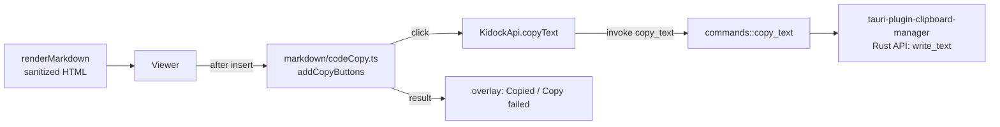
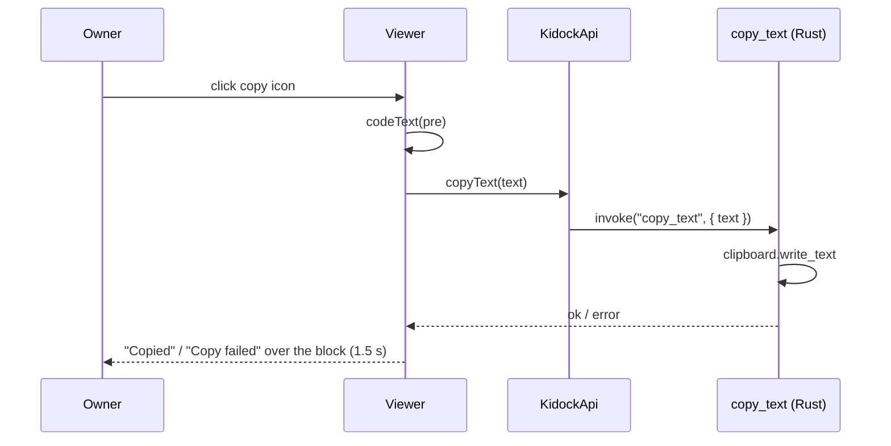

# Issue #21 — Design

## Architecture Overview

## Component Design

### Why a Rust command instead of `navigator.clipboard`

- `navigator.clipboard` needs a secure context and user activation. Whether Kidock's origins qualify differs by WebView (`tauri://localhost` on WKWebView, `http://tauri.localhost` on WebView2, WebKitGTK on Linux), and it cannot be tested without a real WebView.
- This follows the `open_external` pattern from #11: the plugin is used **only from Rust**, and the capability file gains no `clipboard-manager:*` permission. The WebView can ask Kidock to write text and nothing else; it can never read the clipboard.

### Backend

- Dependency: `tauri-plugin-clipboard-manager = "2.5"`. MSRV 1.90 matches ours, and it is built on `arboard` on desktop. The 3.x line is alpha and targets Tauri 3, so it is not used.
  - Verified in the 2.5.0 source: `init()`, `ClipboardExt::clipboard()`, and `Clipboard::write_text(impl Into<Cow<str>>) -> Result<()>`.
- `lib.rs`: `.plugin(tauri_plugin_clipboard_manager::init())`.
- `commands::copy_text(text: String)`:
  - It is `#[tauri::command(async)]`, because clipboard access can block.
  - It delegates to `do_copy_text(&dyn ClipboardWriter, text)`.
  - A clipboard failure maps to the existing `Io` error kind.
  - There is no size limit: the text comes from a document that `read_markdown` already loaded.
- `ClipboardWriter` trait (in `infra`): `TauriClipboard` uses the plugin, and tests use a fake that records the text. This keeps `do_copy_text` testable without a Tauri runtime.

### Frontend

- `KidockApi.copyText(text): Promise<void>`. `tauriApi` invokes `copy_text`; `mockApi` records the text in `copiedTexts` and can be told to fail.
- `src/markdown/codeCopy.ts`, which works on the inserted DOM in the same way as `mermaid.ts`:
  - `codeText(pre)`: takes the `<code>` child's `textContent` (or the `pre`'s) and drops one trailing `\n`.
  - `addCopyButtons(article, copy)`: for each `pre` that is not `.mermaid-src` and is not inside `figure.mermaid-error`, it:
    - wraps the `pre` in `div.code-block` (`position: relative`), so the button does not scroll with the code;
    - appends `button.code-copy` with an inline SVG icon (built with DOM APIs, not HTML strings);
    - adds an empty `div.code-copy-msg[role=status]`.
  - It is idempotent: a `pre` that is already wrapped is skipped.
- Viewer:
  - calls `addCopyButtons` in the existing post-insert layout effect, before `renderDiagrams`;
  - handles clicks through the existing delegated `onClick`, checking `closest("button.code-copy")` before the link handling;
  - on click, calls `api.copyText(codeText(pre))`, then shows the message (`.visible` for 1.5 s). The timer is stored on the element and restarted on a second click.
- CSS:
  - The button is a small square at the top-right; it is half-opaque and becomes opaque on hover or focus.
  - The message is centered over the block, with a solid background and a fade-out, and it uses the light and dark theme tokens.

## Data Flow

## Domain Models

None (UI and an infra adapter only).
