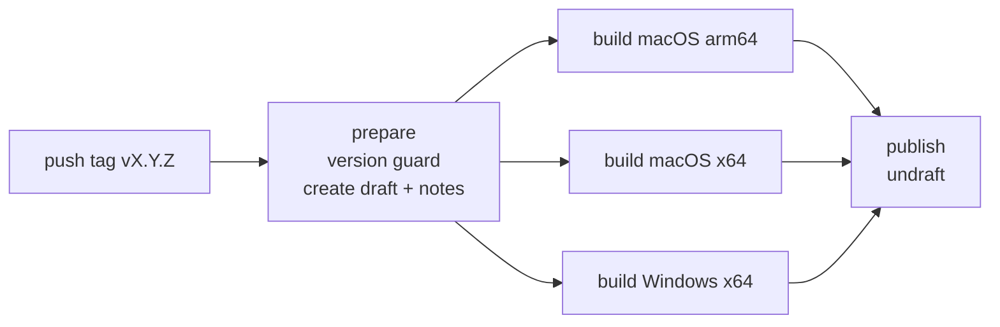
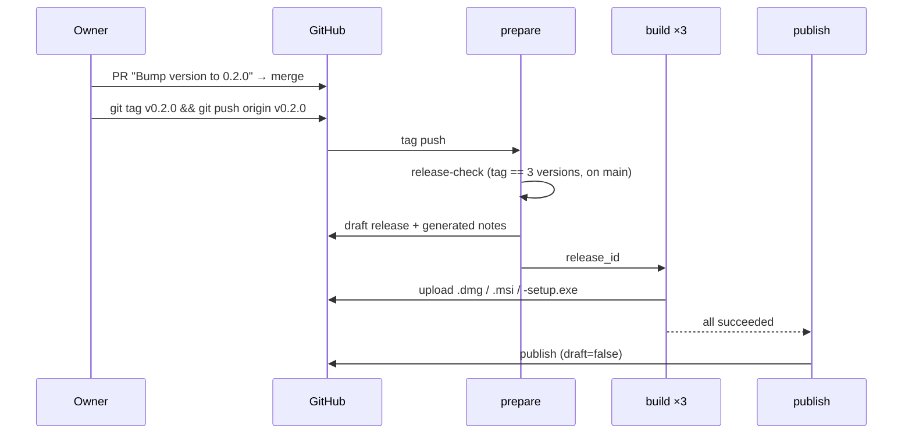

# Issue #23 — Design

## Architecture Overview

New file: `.github/workflows/release.yml`. It is separate from `ci.yml`: the tagged commit is required to be on `main`, where CI has already run. The version guard catches the mistake that CI cannot.

## Component Design

### Jobs

| Job | Runs on | Permissions | What it does |
|---|---|---|---|
| `prepare` | ubuntu-latest | `contents: write` | Checks the version and that the tag is on `main`. Creates a **draft** release with generated notes (`gh release create --draft --generate-notes --notes "<install header>"`, plus `--prerelease` for `-suffix` tags). Outputs `release_id`. |
| `build` (matrix) | macos-latest ×2, windows-latest | `contents: write` | Builds with `tauri-apps/tauri-action@v1` and `releaseId` from `prepare`, uploading assets to that draft. `uploadUpdaterJson: false`. |
| `publish` | ubuntu-latest | `contents: write` | Runs only if every build succeeded (`needs: build`). `gh release edit <tag> --draft=false`. |

- **Why a draft first**: with `releaseDraft: false`, each matrix job's tauri-action would create or publish the release on its own, so it could go public with only some assets (F6). One draft, uploaded to by `releaseId`, then one publish step, makes publishing all-or-nothing.
- **Concurrency**: `group: release-${{ github.ref }}` without cancellation, so a re-pushed tag never races itself.

### Build matrix

From the Tauri v2 GitHub pipeline guide (verified):
- `macos-latest` with `args: --target aarch64-apple-darwin`
- `macos-latest` with `args: --target x86_64-apple-darwin`
- `windows-latest` with `args: ""`

Rust targets are added with `dtolnay/rust-toolchain@stable` (`targets:` set for macOS only). Node comes from `.nvmrc`, with `npm ci`, and `Swatinem/rust-cache@v2` (the same setup as `ci.yml`).

### Version guard (`scripts/release-check.mjs`)

- `scripts/lib/version.mjs` holds the pure functions:
  - `parseTag("v0.2.0-beta.1")` returns `{ version, prerelease }`, or throws on a bad tag.
  - `readVersions({ packageJson, cargoToml, tauriConf })` returns the three versions.
  - `checkVersions(tag, versions)` lists the mismatches.
- `scripts/release-check.mjs <tag>`:
  - reads the three files and runs the checks;
  - with `--github-output`, writes `version=` and `prerelease=` to `$GITHUB_OUTPUT`;
  - exits non-zero with a clear message on a mismatch.
- The "on `main`" check is done in the workflow with `git merge-base --is-ancestor "$GITHUB_SHA" origin/main`, after a full-history checkout.

### Version bump helper (`scripts/set-version.mjs`, `npm run version:set -- X.Y.Z`)

- Pure functions in `scripts/lib/version.mjs` rewrite each file's version field in place, without touching other formatting:
  - `package.json`: the top-level `"version"`;
  - `Cargo.toml`: `version` in `[package]` only;
  - `tauri.conf.json`: the top-level `"version"`.
- The script then runs `npm install --package-lock-only` (for `package-lock.json`) and `cargo update -p kidock --offline` (for `Cargo.lock`).

### Release notes

- `.github/release.yml` sets the categories from F5 and excludes PRs labelled `skip-changelog`. The label is created as part of this Issue.
- `gh release create --generate-notes` uses GitHub's generate-notes API, so the result is checked once with `gh api repos/{owner}/{repo}/releases/generate-notes` before merging. That call creates nothing.
- Process change (`CLAUDE.md`): each PR carries its Issue's label (`enhancement` / `bug` / `documentation`). Unlabelled PRs land in "Other changes".
- The install header in the release body says:
  - macOS: open the `.dmg`, drag the app to Applications; on first launch, right-click → Open (or allow it in System Settings → Privacy & Security).
  - Windows: SmartScreen → More info → Run anyway.

### Unsigned builds, ready for signing

- `tauri.conf.json`: `bundle.macOS.signingIdentity: "-"` (ad-hoc).
- The `build` job passes the optional signing secrets as env vars (`APPLE_CERTIFICATE`, `APPLE_CERTIFICATE_PASSWORD`, `APPLE_SIGNING_IDENTITY`, `APPLE_API_*`). They are empty today, so the ad-hoc identity applies. When certificates arrive, adding the secrets switches to real signing and notarization. The design doc for that Issue will confirm that the env var overrides the config value.
- Windows signing (a `certificateThumbprint` or `signCommand`) is a later Issue.

### Docs

- `docs/releasing.md`: the procedure (F9), what the workflow does, how to recover from a failed release (delete the draft and the tag, fix, re-tag), and the unsigned-build caveats.
- README: a short "Install" section that links to Releases.

## Data Flow

## Domain Models

None. The version helpers are repository tooling (`scripts/lib/version.mjs`).
