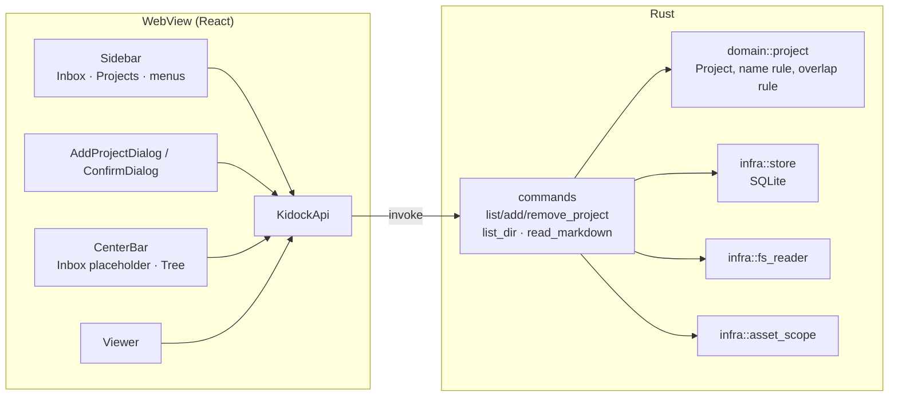
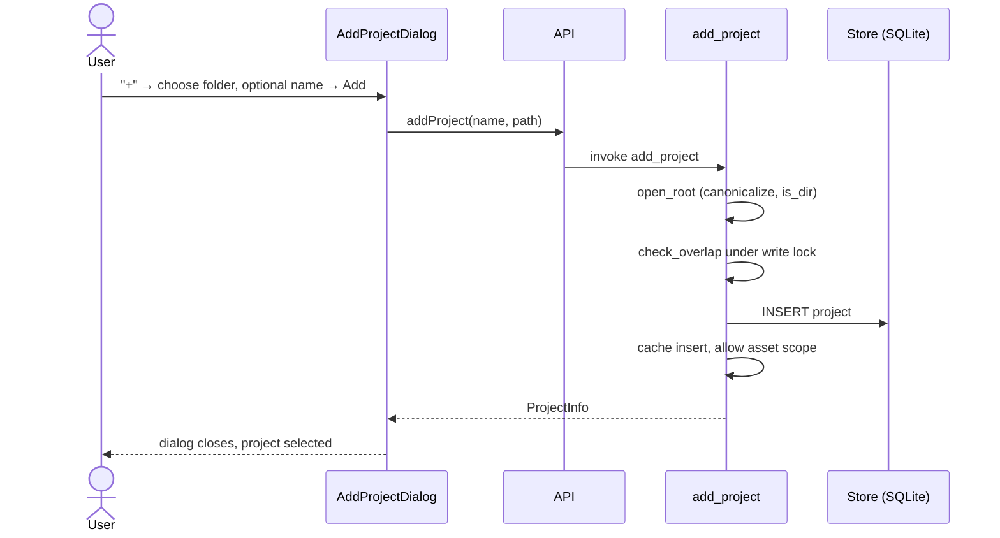
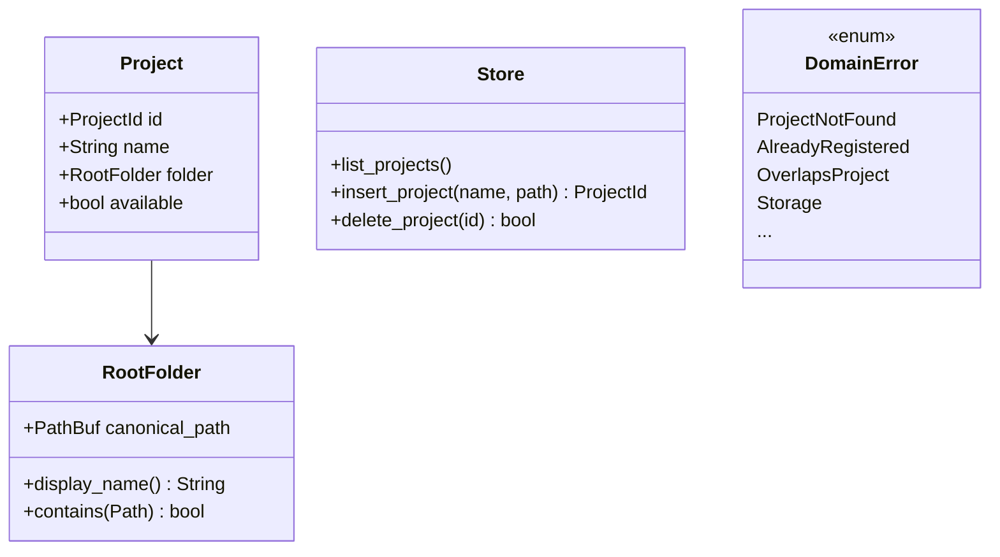

# Issue #5 — Design

Verified on 2026-11-24: `rusqlite` 0.43 (`bundled` feature, MSRV 1.89). Tauri 2.12.7: `PathResolver::app_data_dir()`, and command arguments are camelCase in JS by default (`tauri-macros` `ArgumentCase::Camel`).

## Architecture Overview



## Component Design

### Rust

**domain**

- `project.rs`:
  - `ProjectId(i64)`, the SQLite rowid.
  - `Project { id, name, folder: RootFolder, available: bool }`. `RootFolder` (from #1) keeps the canonical path and the containment check.
  - `project_name(input: Option<&str>, folder: &Path) -> String`: trims the input, falls back to the folder name for an empty one, and truncates to 100 characters at a char boundary.
  - `check_overlap(existing: &[&Path], candidate: &Path, case_insensitive: bool) -> Result<(), DomainError>`: returns `AlreadyRegistered` for an equal path, or `OverlapsProject` when either path contains the other. Paths are compared component-wise, lowercased when `case_insensitive` is set. Callers pass `cfg!(any(windows, target_os = "macos"))`.
- `root.rs`: `RootId` is removed. `RootFolder::new(canonical_path)` stays as the folder abstraction.
- `error.rs`: `NoRootSelected` is replaced by `ProjectNotFound`. New variants: `AlreadyRegistered`, `OverlapsProject`, `Storage(String)`.

**infra**

- `store.rs`, `Store` wrapping `rusqlite::Connection`:
  - `open(path)` / `open_in_memory()` both run `migrate()`.
  - `migrate()`: version 1 creates `projects(id INTEGER PRIMARY KEY, name TEXT NOT NULL, path TEXT NOT NULL UNIQUE, created_at INTEGER NOT NULL)`. Migrations are keyed on `PRAGMA user_version` and run in a transaction.
  - `list_projects() -> Vec<StoredProject { id, name, path }>`, `insert_project(name, path) -> ProjectId`, `delete_project(id) -> bool`.
  - Errors map to `DomainError::Storage`.
  - Also enables `PRAGMA foreign_keys = ON` and WAL journal mode, ready for #6/#7 tables.
- `fs_reader.rs`: `open_root(path) -> RootFolder` (no id). `list_dir` and `read_markdown` are unchanged.
- `asset_scope.rs`: `allow_root` is unchanged.

**state**

```rust
pub struct AppState {
    store: Mutex<Store>,
    projects: RwLock<BTreeMap<ProjectId, Project>>,  // cache of the store
    pub rules: ExclusionRules,
}
```

- `AppState::load(store)` reads all rows and re-canonicalizes each path. On failure the project is kept with its stored path and `available = false`.
- `project(id) -> Result<Project, DomainError>` returns a clone, so no lock is held during I/O.

**commands** (all `#[tauri::command(async)]`, each delegating to a `do_*` fn)

| Command | Args (JS) | Returns |
|---|---|---|
| `list_projects` | – | `ProjectInfo[]` sorted by name, then id |
| `add_project` | `{ name: string \| null, path: string }` | `ProjectInfo` |
| `remove_project` | `{ projectId }` | `void`. An unknown id gives `ProjectNotFound`. |
| `list_dir` | `{ projectId, rel }` | `TreeEntry[]` |
| `read_markdown` | `{ projectId, rel }` | `string` |

`ProjectInfo { id, name, path, available }`.

`do_add_project`:
1. `open_root(path)`: canonicalizes and checks that the path is a directory.
2. Under the `projects` write lock: `check_overlap`, then `store.insert_project`, then insert into the cache. Holding the lock across both makes two concurrent adds of the same folder impossible.
3. The `add_project` wrapper then calls `asset_scope::allow_root`.

`set_root` is removed.

**lib.rs**: in `setup`, resolve `app.path().app_data_dir()`, create it, open `kidock.db`, run `AppState::load`, allow the asset scope for available projects, and `manage` the state. A failure to open the DB aborts startup with a clear error.

### Frontend

**API** (`KidockApi`):

```ts
pickFolder(): Promise<string | null>;
listProjects(): Promise<ProjectInfo[]>;
addProject(name: string | null, path: string): Promise<ProjectInfo>;
removeProject(projectId: number): Promise<void>;
listDir(projectId: number, relPath: string): Promise<TreeEntry[]>;
readMarkdown(projectId: number, relPath: string): Promise<string>;
```

`mockApi` holds several in-memory projects (`createMockApi({ projects: [{ name, path, files }] })`) and applies the same overlap and name rules, so browser dev and the tests behave like the backend.

**Components**

- `App`: loads projects. Holds `view: { kind: "inbox" } | { kind: "project", id }` and `openFile: { projectId, rel } | null`. Lays out the three panes.
- `Sidebar`: the Inbox item, `ProjectsHeader` (title + "+"), and the `ProjectList` rows. Each row has a "⋯" button opening `ProjectMenu`.
- `ProjectMenu`: a small popover with `role="menu"`. It closes on Escape, an outside click, or after an action.
- `Modal`: a shared overlay with `role="dialog"`, `aria-modal`, `aria-labelledby`, and focus on open. Escape closes it. A custom element is used because jsdom has no `HTMLDialogElement.showModal`.
- `AddProjectDialog` and `ConfirmDeleteDialog` are built on `Modal`.
- `CenterBar`: in the Inbox view it shows an empty state ("No notifications yet."). In the project view it shows the project title plus `Tree` (keyed by project id), or "Folder not found" for an unavailable project.
- `Tree` and `Viewer` take `projectId`.

**Layout CSS**: `grid-template-columns: minmax(180px, 240px) minmax(220px, 320px) minmax(0, 1fr)`, with each pane `overflow: auto` (the #1 scroll fix applied to three columns).

## Data Flow



## Domain Models



## Notes for Later Issues

- #6 adds a `files` table (project_id FK `ON DELETE CASCADE`) and starts one watcher per available project.
- #7 adds `inbox_items` (FK cascade), so removing a project removes its items in one transaction.
