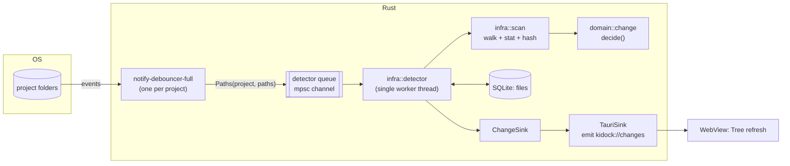
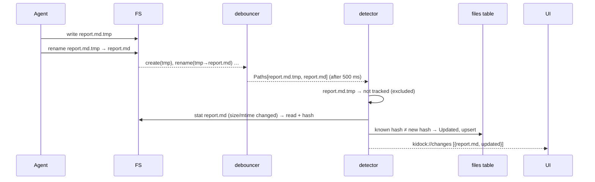
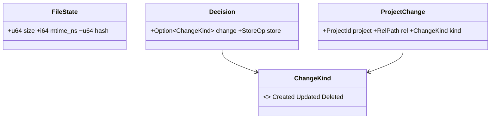

# Issue #6 — Design

Verified 2026-11-24 against the crate sources:
- `notify` 9.0.0 and `notify-debouncer-full` 0.8.0: `new_debouncer(timeout, tick_rate, handler)`, `Debouncer::watch(path, RecursiveMode::Recursive)`, `DebounceEventResult = Result<Vec<DebouncedEvent>, Vec<Error>>`, `Event { kind, paths, .. }`, `Event::need_rescan()`.
- The debouncer already merges rename chains and drops duplicate creates. We still don't trust event kinds.

## Architecture Overview



A single detector thread processes the queue serially, so no two reconciliations for the same project race, and SQLite access is sequential. The queue carries these messages:
- `Paths { project, paths }`: from the debouncer
- `Baseline { project }`: on add, or when the project was never baselined
- `Rescan { project }`: at startup, or after `need_rescan` / watcher errors
- `Forget { project }`

## Component Design

### domain (pure)

- `filter.rs`:
  - `ExclusionRules` gains temp/backup patterns: suffixes `~`, `.tmp`, `.temp`, `.swp`, `.swo`, `.part`, `.crdownload`, all case-insensitive. The existing names and hidden rule are unchanged.
  - New `is_tracked(rel: &RelPath, rules) -> bool`: no component is excluded, and the last component is Markdown.
- `change.rs`:
  - `FileState { size: u64, mtime_ns: i64, hash: u64 }` and `ChangeKind { Created, Updated, Deleted }`.
  - `decide(known: Option<&FileState>, now: Option<&FileState>) -> Decision { change: Option<ChangeKind>, store: StoreOp }`, where `StoreOp ∈ { Upsert(FileState), Delete, Keep }`:

    | known | now | result |
    |---|---|---|
    | None | Some | Created, Upsert |
    | Some | None | Deleted, Delete |
    | Some(a) | Some(b), same hash | no change; Upsert if mtime/size differ (touch) |
    | Some(a) | Some(b), other hash | Updated, Upsert |
    | None | None | nothing |

  - `needs_hash(known, size, mtime_ns) -> bool`: false when size and mtime both match, in which case the known hash is reused.
- `hash.rs`: `fnv1a64(&[u8]) -> u64`, tested against published test vectors.

### infra

- `store.rs` migration **v2**:
  ```sql
  ALTER TABLE projects ADD COLUMN baselined INTEGER NOT NULL DEFAULT 0;
  CREATE TABLE files (
    project_id INTEGER NOT NULL REFERENCES projects(id) ON DELETE CASCADE,
    rel_path   TEXT    NOT NULL,
    size       INTEGER NOT NULL,
    mtime_ns   INTEGER NOT NULL,
    hash       INTEGER NOT NULL,   -- u64 stored as i64 bits
    PRIMARY KEY (project_id, rel_path)
  );
  ```
  New methods:
  - `file_states(project) -> HashMap<String, FileState>`
  - `file_states_under(project, prefix)`
  - `apply_file_ops(project, ops)`: one transaction
  - `mark_baselined(project)` and `is_baselined(project)`
- `scan.rs`:
  - `walk(root, rules) -> Vec<(RelPath, size, mtime_ns)>`: recursive, applies the exclusions, does **not** follow directory symlinks (avoids loops and escapes), and skips non-UTF-8 names.
  - `observe(root, rel, known) -> Option<FileState>`: stat, then hash only when needed. Errors such as a file vanishing mid-read count as absent.
- `detector.rs`:
  - `Detector { state: Arc<AppState>, sink: Arc<dyn ChangeSink> }` with `handle(msg)`.
  - **Paths**: map each event path to a `RelPath` under the project's canonical root (paths outside are ignored). Build the candidate set:
    - the path itself, if tracked
    - all known files under it (it may have been a directory that was removed or moved away)
    - if it is now a directory, every tracked file under it from `walk`
  - Each candidate goes through `observe` and then `decide`. Store ops are applied in one transaction, and the sink receives one batch.
  - **Baseline**: `walk` + `observe` for all files, upsert, `mark_baselined`. No changes are emitted.
  - **Rescan**: the union of the walk and the known files, with each reconciled as above, emitting the changes.
- `watcher.rs`:
  - `Watchers { tx: Sender<Msg>, active: HashMap<ProjectId, Debouncer<..>> }`.
  - `start(project)` creates a debouncer (500 ms) whose handler sends `Paths`, or `Rescan` on `need_rescan()` or errors, and watches the canonical root recursively.
  - `stop(project)` drops the debouncer and sends `Forget`.
- `ChangeSink` trait (`infra::sink`): `fn deliver(&self, changes: &[ProjectChange])`. `TauriSink<R>` emits `kidock://changes`. Tests use a collecting sink.

### state / lib / commands

- Tauri manages `Arc<AppState>`, and commands take `State<'_, Arc<AppState>>` (the `do_*` functions still take `&AppState`).
- `AppState` gains `watchers: Mutex<Option<Watchers>>`, set in `setup` once the detector thread has started.
- In `setup`, for each available project: if not baselined, send `Baseline`, otherwise `Rescan`. Then `watchers.start(project)`.
- `add_project`: after the insert, send `Baseline` first, then start the watcher. The serial queue guarantees that the baseline is processed before any events.
- `remove_project`: `watchers.stop(id)`. The `files` rows go away by cascade.

### Frontend

- `KidockApi.onChanges(handler): () => void`:
  - `tauriApi` uses `listen("kidock://changes")` from `@tauri-apps/api/event` (covered by the `core:default` capability). Verify `core:event:allow-listen` in the generated schema.
  - `mockApi` exposes `emitChanges(changes)` for tests and browser dev.
- `FileChange = { projectId, relPath, kind: "created" | "updated" | "deleted" }`.
- `App` subscribes once. When a batch touches the current project, it bumps `treeVersion`. `Tree` → `DirChildren` refetch on version change **without** unmounting, so expansion state survives. The old entries stay visible until the new listing arrives, so there is no flash.

## Data Flow — atomic save



## Domain Models



## Testing

- Unit: `decide`, `needs_hash`, `fnv1a64`, `is_tracked` and the temp patterns, `walk` (exclusions, no symlink following), store v2 migration (v1 → v2 upgrade keeps projects), and the detector on a temp dir with a collecting sink, driven by synthetic `Paths` messages.
- Integration (`tests/watch.rs`, no Tauri runtime, so it also runs on Windows): the real `Watchers` on a temp dir, waiting for batches with a generous timeout. Cases: create, in-place update, atomic save (write temp + `fs::rename`), identical rewrite, rename, delete, a directory moved in, and excluded paths.
