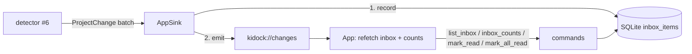
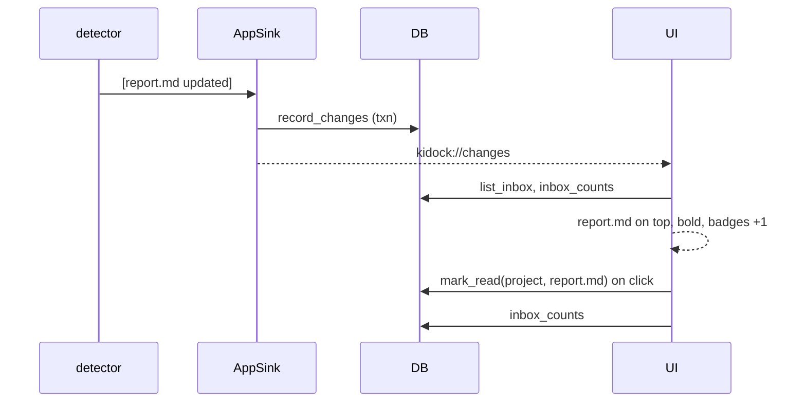
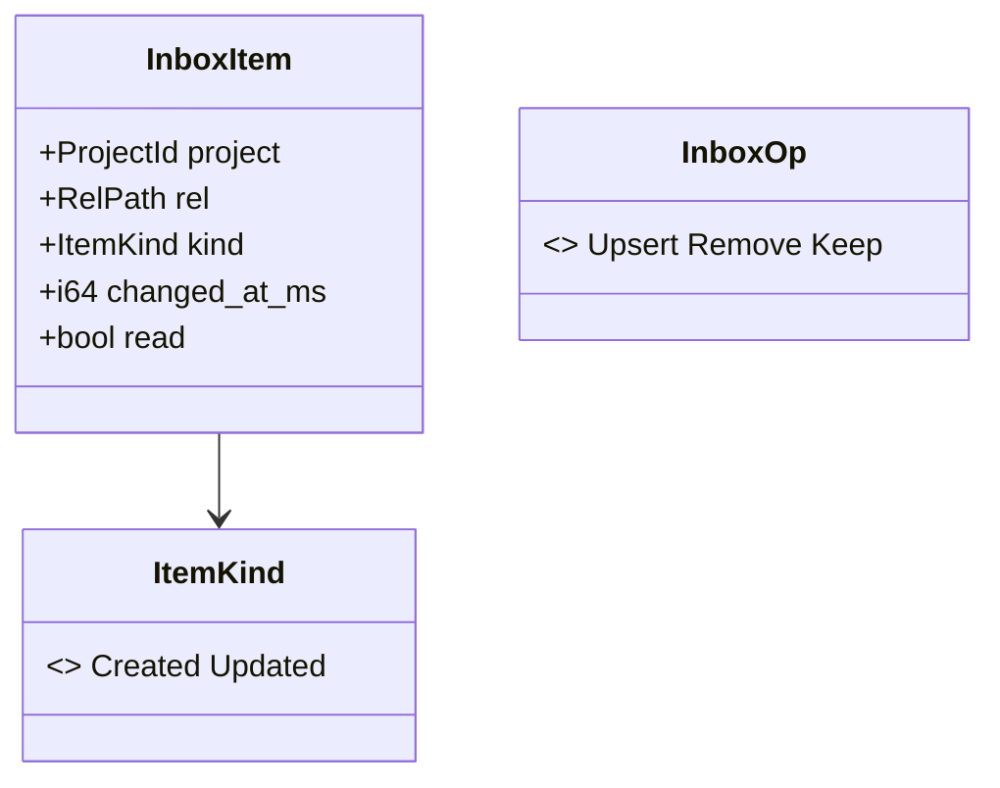

# Issue #7 — Design

## Architecture Overview



The `TauriSink` from #6 becomes `AppSink`. For each batch it applies the Inbox rules in one transaction and then emits the event. Because the write happens first, the UI's refetch always sees the new items.

## Component Design

### domain

`inbox.rs`:
- `InboxItem { project, rel, kind: ItemKind, changed_at_ms: i64, read: bool }`, where `ItemKind ∈ { Created, Updated }`.
- `apply(existing: Option<&InboxItem>, change: ChangeKind, now_ms) -> InboxOp`, with `InboxOp ∈ { Upsert(InboxItem), Remove, Keep }`:

  | existing | change | result |
  |---|---|---|
  | none | created / updated | Upsert { kind = change, unread, now } |
  | unread created | updated | Upsert { kind = created, unread, now } |
  | unread / read, any | created / updated | Upsert { kind = change, unread, now } (except the row above) |
  | any | deleted | Remove |
  | none | deleted | Keep |

### infra

- Store migration **v3**:
  ```sql
  CREATE TABLE inbox_items (
    project_id INTEGER NOT NULL REFERENCES projects(id) ON DELETE CASCADE,
    rel_path   TEXT    NOT NULL,
    kind       TEXT    NOT NULL CHECK (kind IN ('created','updated')),
    changed_at INTEGER NOT NULL,          -- ms since epoch
    read       INTEGER NOT NULL DEFAULT 0,
    PRIMARY KEY (project_id, rel_path)
  );
  CREATE INDEX inbox_by_time   ON inbox_items (changed_at DESC);
  CREATE INDEX inbox_by_unread ON inbox_items (read, project_id);
  ```
- `Store` methods:
  - `record_changes(&[ProjectChange], now_ms)`: reads the existing rows for the batch's paths, applies `domain::inbox::apply`, and writes in one transaction.
  - `list_inbox(limit) -> Vec<InboxRow>`, joined with `projects.name`.
  - `unread_counts() -> (total, Vec<(ProjectId, n)>)`.
  - `mark_read(project, rel) -> bool` and `mark_all_read() -> usize`.
- `sink.rs`: `AppSink<R> { state: Weak<AppState>, app }`. `deliver` records into the store (via `state.store()`), then emits `kidock://changes`.
  - The `Weak` avoids an `Arc` cycle through `watchers → detector → sink`.
  - A store error is logged, and the event is emitted anyway so the tree still refreshes.

### commands

| Command | Args | Returns |
|---|---|---|
| `list_inbox` | – | `InboxItemDto[]` `{ projectId, projectName, relPath, kind, changedAt, read }`, newest first, up to 500 |
| `inbox_counts` | – | `{ total, byProject: [{ projectId, unread }] }` |
| `mark_read` | `{ projectId, rel }` | `boolean`: whether an unread item was marked |
| `mark_all_read` | – | `number` of items marked |

`rel` is validated with `RelPath` (wire form), so a bad path is rejected rather than silently ignored.

### Frontend

- `KidockApi` adds `listInbox()`, `inboxCounts()`, `markRead(projectId, relPath)`, and `markAllRead()`. The mock implements the same rules, and its `emitChanges` records the changes into its inbox.
- `components/InboxList.tsx`: the header ("Inbox" + "Mark all as read") and a `role="list"` of item buttons, each with the kind icon (`aria-label` New / Updated), name, project · folder, relative time, and the unread dot. The selected item is highlighted.
- `util/relativeTime.ts`: `formatRelative(ms, nowMs)`, pure and tested.
- `App`:
  - Holds `inbox` and `counts` and refetches both on mount, on `onChanges`, and after mark or remove actions.
  - `openFile` from either the Inbox or the tree calls `markRead` (optimistic for the Inbox item), then refetches the counts.
- `Sidebar`: a badge next to Inbox and next to each project (`aria-label="N unread"`).

## Data Flow



## Domain Models


