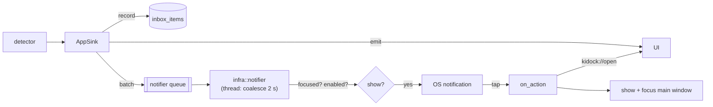
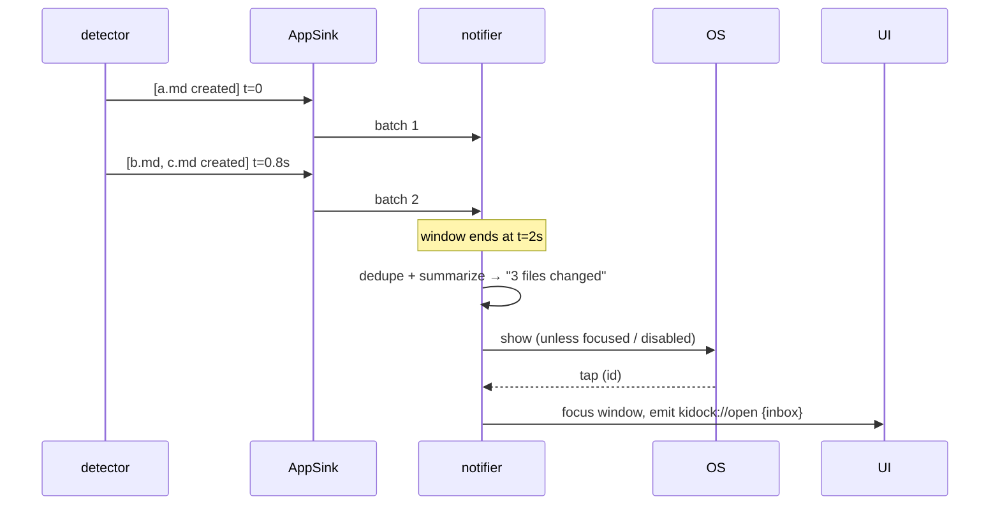
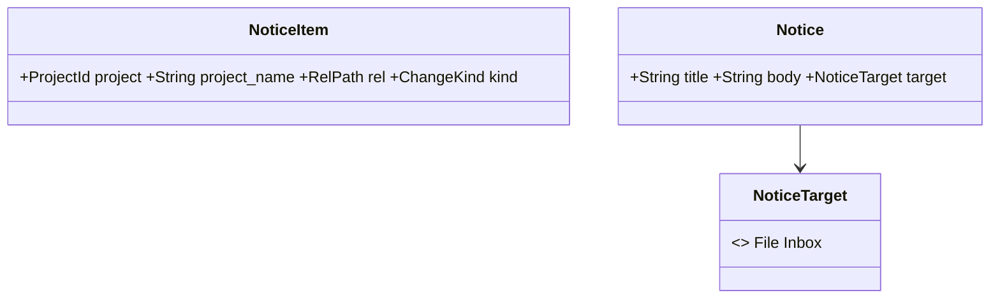

# Issue #8 — Design

Verified 2026-11-24 against `tauri-plugin-notification` 2.8.1 source:
- `app.notification().builder().id(i32).title(..).body(..).show()`. Delivery is dispatched on a background task.
- Desktop `permission_state()` / `request_permission()` always return `Granted`.
- `Notification::on_action(handler)` reports clicks with `action_id() == "tap"` and `notification().id()`. On Windows a click is reported only while the toast is visible.
- 3.0 is alpha, so we stay on 2.x.

## Architecture Overview

## Component Design

### domain

`notice.rs`:
- `Notice { title: String, body: String, target: NoticeTarget }`, where `NoticeTarget ∈ { File { project, rel }, Inbox }`.
- `summarize(changes: &[NoticeItem]) -> Option<Notice>`. Each `NoticeItem` is `{ project, project_name, rel, kind }` and is already deduplicated, keeping the last kind per file.
  - Empty → `None`.
  - One item → a `File` target.
  - Several → an `Inbox` target.
- `dedupe(items)`: keeps the last occurrence per `(project, rel)` and drops deletions.

### infra

- `notifier.rs`:
  - `Notifier::spawn(present: Arc<dyn Presenter>) -> NotifierHandle`, a thread with a channel.
  - On the first batch it starts a 2 s window and collects every batch until the window ends. It then dedupes and summarizes, and calls `present.show(notice)` if `present.should_show()`.
  - `Presenter` is a trait: production uses `TauriPresenter` (plugin + window focus + settings). Tests use a fake. The window length is injectable.
- `TauriPresenter`:
  - `should_show()` returns true when notifications are enabled (settings) **and** the main window is not focused.
  - `show(notice)` assigns an incrementing `i32` id, remembers `id → target` (keeping the last 100), and calls the plugin.
  - `on_tap(id)`: `main` window → `unminimize`, `show`, `set_focus`, then emits `kidock://open` with `{ projectId, relPath } | { inbox: true }`.
- Store migration **v4**: `settings(key TEXT PRIMARY KEY, value TEXT NOT NULL)`, with `get_setting` / `set_setting`. Key: `notifications.enabled` (`"1"` / `"0"`, default on).
- `AppSink` gets an optional `NotifierHandle`. After recording, it forwards the batch as `NoticeItem`s, with project names from the project cache.

### commands

- `get_notifications_enabled() -> bool`
- `set_notifications_enabled({ enabled }) -> void`

### Frontend

- `KidockApi`: `getNotificationsEnabled()`, `setNotificationsEnabled(b)`, and `onOpenRequest(handler)`, which listens to `kidock://open`.
- `Sidebar` footer: a bell toggle button, "Notifications on" / "Notifications off", with `aria-pressed`.
- `App`: on an open request, select the Inbox and `open(file)` (which marks it read), or just select the Inbox.

## Data Flow

## Domain Models

