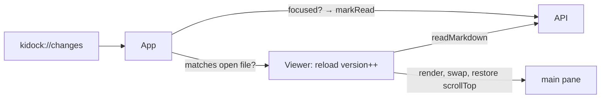
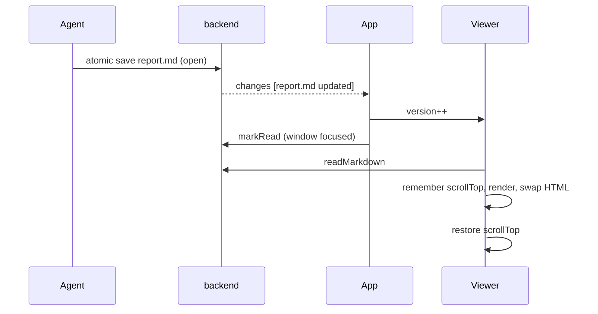

# Issue #9 — Design

## Architecture Overview

## Component Design

- **`App`** (it already subscribes to `onChanges`):
  - For each batch, it looks for a change to the open file.
  - `updated` / `created` → increment `fileVersion`. If `document.hasFocus()`, it also calls `markRead` and refreshes the Inbox.
  - `deleted` → increment `fileVersion` as well. The reload fails with `NotFound`, and the existing error state shows "no longer exists".
- **`Viewer`**:
  - New prop `version: number`. The load effect depends on `[projectId, relPath, version]`.
  - A **reload** (same file, new version): before swapping the HTML, it stores `scrollTop` of its scroll container (`.pane-main`, the nearest scrollable ancestor). In a layout effect after the swap, it restores that offset (the browser clamps it to the new height).
  - A **new file**: it scrolls the container to the top in a layout effect.
  - A request counter discards stale responses, so only the latest load can set state.
- The scroll container is found through a ref on the Viewer root, and then `parentElement`. `Viewer` is a direct child of `.pane-main`.

## Data Flow

## Domain Models

No new domain models: this is UI state only (`version`, saved `scrollTop`).
